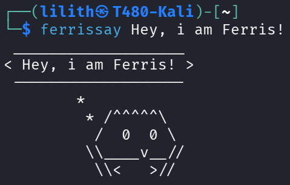

# ferrissay

a cowsay remake using Rust's mascot "Ferris", obviously written in Rust

Copyright (C) 2026 ghlilith1k

distributed on the GNU/GPLv2 license. see https://www.gnu.org/licenses/old-licenses/gpl-2.0.html

  

# Description
ferrissay is just a remake of the popular linux CLI program "cowsay",
the user types a word or a phrase after the command and an ASCII art
of Ferris appears with a cloud floating above him saying the word/phrase
the user typed, just like cowsay but with a crab, pretty simple no?
it's still in early development but it already works, there might be some
visual bugs for now but i'm gonna fix them in the future.
**bugs are expected, please report them in the "issues" tab**

# How to Install:
    make

# Usage:
    ferrissay [-u] [message]

# About
**note: ferrissay has only been tested on GNU/linux, stability/full functionality and compilation on other OSes is not guaranteed.**

- current version: 0.1.1 BETA
- current stable: none
- AI code: none
- for future releases: see "Dev Notes"

# Dev Notes / Known Issues
- fix text box glitching when phrase gets really long
- make Ferris prettier
- make new Ferris variations and enable them with flags

# Changelog

## release 0.1.0 BETA - packaged
just the standard program, starting point for future releases

## release 0.1.1 BETA - pending
- added ferries_claws_down and made it default
- modified bubble design
- switched from free variables to struct
- fixed first-argument bug, now the command itself doesn't get printed